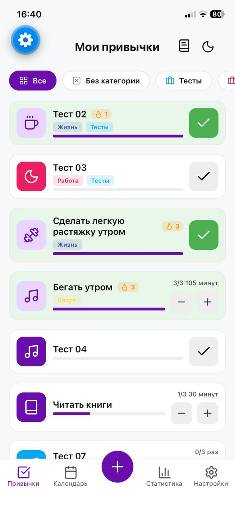
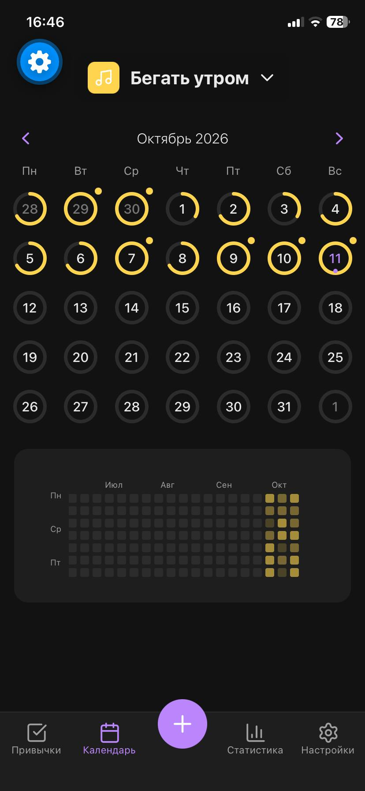
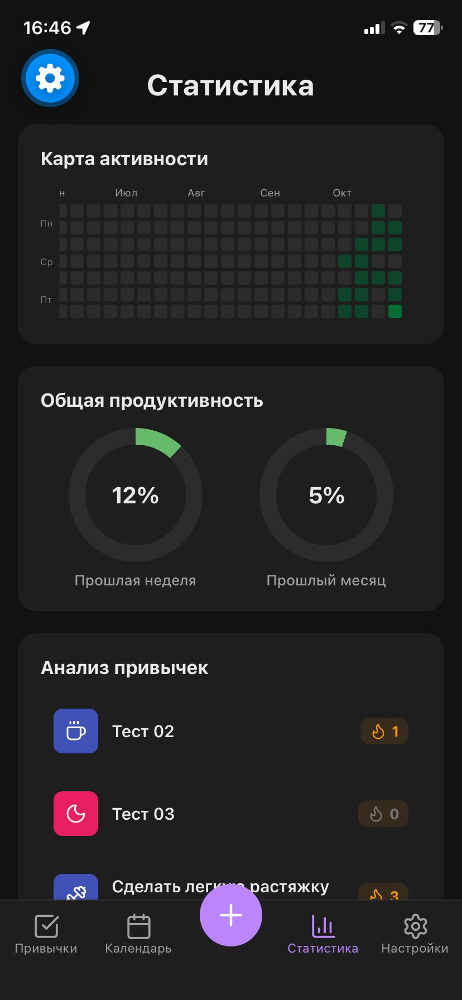

# TapyTap

Мобильный трекер привычек на Expo и React Native с бэкендом на Supabase.

<p>
  
  
  
</p>

Разбор проекта с решениями и проверкой: [bakytzhan.pages.dev/work/tapytap](https://bakytzhan.pages.dev/work/tapytap).

## Что умеет

- Привычки с категориями, иконками и напоминаниями. Бывают отметки «сделано» и количественные, с единицей измерения.
- Серии выполнения.
- Календарь с тепловой картой.
- Статистика общая и по каждой привычке.
- Журнал заметок.
- Архив привычек.
- Ручная сортировка категорий и привычек.
- Светлая и тёмная темы, а также режим «как в системе».
- Аккаунт по email и паролю, данные хранятся в Supabase.

Всего 15 экранов. Интерфейс на русском.

## Стек

- Expo SDK 57, React Native 0.86 (New Architecture), React 19, TypeScript
- Zustand: один стор `src/store/useHabitStore.ts`, все экраны читают и пишут данные только через него
- Supabase: Auth, Postgres, правила доступа RLS
- React Navigation, Reanimated, Gesture Handler, react-native-calendars, react-native-gifted-charts, Lucide

## Доступ к данным

Ключ клиента Supabase публичный по замыслу, поэтому данные защищают только правила RLS в базе. На всех таблицах они проверяют владельца. Для таблицы связей привычек с категориями владелец проверяется через привычку, а при создании связи — ещё и через категорию.

Схема базы хранится в репозитории в виде миграций (`supabase/migrations/`):

- `…_remote_schema.sql` — схема прода, снятая через `supabase db pull`;
- `…_habit_categories_owner_rls.sql` — исправление правил доступа. До него любой вошедший пользователь мог читать, создавать и удалять чужие связи. Исправление проверено на локальной базе 14 сценариями на двух аккаунтах.

## Запуск

Нужны [Bun](https://bun.sh), а для локальной базы — Docker и [Supabase CLI](https://supabase.com/docs/guides/local-development).

```bash
bun install
```

**Клиент Supabase.** Файл `src/supabase/supabaseClient.ts` не хранится в git, его нужно создать:

```ts
import "react-native-url-polyfill/auto";
import AsyncStorage from "@react-native-async-storage/async-storage";
import { createClient } from "@supabase/supabase-js";

export const supabase = createClient(SUPABASE_URL, SUPABASE_ANON_KEY, {
  auth: {
    storage: AsyncStorage,
    autoRefreshToken: true,
    persistSession: true,
    detectSessionInUrl: false,
  },
});
```

**Локальная база.** Схему и правила доступа поднимают миграции:

```bash
supabase start      # URL и anon-ключ покажет supabase status
supabase db reset   # накатить миграции с нуля
```

С Android-эмулятора база доступна по `http://10.0.2.2:54321`, с телефона в той же сети — по LAN-адресу компьютера. Остальные команды и известные проблемы описаны в [`supabase/RUNBOOK.md`](supabase/RUNBOOK.md).

**Приложение:**

```bash
npx expo start --go   # в Expo Go на телефоне
bun start             # с development build
bun run android       # собрать и запустить на Android
```

Каталоги `android/` и `ios/` не хранятся в репозитории, их генерирует `expo prebuild` или `expo run:*`.

## Проверка

```bash
npx tsc --noEmit
npx expo-doctor
```

Сейчас проверка типов проходит без ошибок, а `expo-doctor` проходит все 21 проверку. Основные сценарии прогоняются вручную на iPhone в Expo Go.

## Ограничения

- Приложение не опубликовано в сторах.
- Автоматических тестов нет.
- Параметры навигации на большинстве экранов типизированы как `any`, поэтому ошибки маршрутов проверка типов не ловит.
- Офлайн-кэша нет: экраны перезапрашивают данные из Supabase при каждом открытии.
